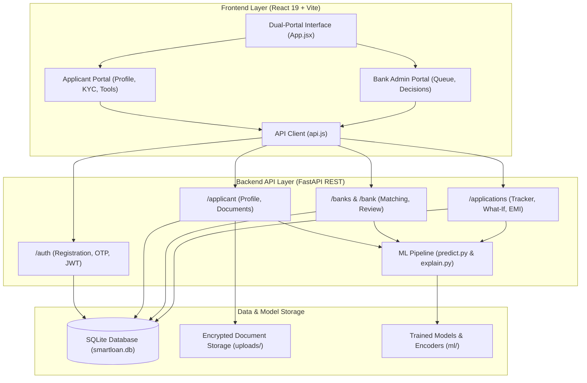

# SmartLoanAI

### AI Banking and Multi-Lender Underwriting Platform

[](https://www.python.org/)
[](https://fastapi.tiangolo.com/)
[](https://react.dev/)
[](https://vitejs.dev/)
[](https://xgboost.readthedocs.io/)
[](https://shap.readthedocs.io/)
[](LICENSE)

SmartLoanAI is a full-stack financial intelligence application designed to modernize retail loan origination and underwriting. The platform combines machine learning credit risk modeling, Explainable AI (XAI) feature attribution, applicant document verification, an interactive financial planning suite, a multi-bank eligibility match engine, and an authorized credit officer decision terminal.

---

## Table of Contents

- [Overview](#overview)
- [System Architecture](#system-architecture)
- [Key Features](#key-features)
  - [Applicant Portal](#applicant-portal)
  - [Bank Officer Underwriting Terminal](#bank-officer-underwriting-terminal)
  - [Explainable AI Engine](#explainable-ai-engine)
  - [Multi-Lender Match Engine](#multi-lender-match-engine)
  - [Financial Tools and Calculators](#financial-tools-and-calculators)
- [Technology Stack](#technology-stack)
- [Repository Structure](#repository-structure)
- [Prerequisites](#prerequisites)
- [Installation and Setup](#installation-and-setup)
  - [1. Clone Repository](#1-clone-repository)
  - [2. Environment Configuration](#2-environment-configuration)
  - [3. Backend Setup](#3-backend-setup)
  - [4. Frontend Setup](#4-frontend-setup)
  - [5. Machine Learning Pipeline](#5-machine-learning-pipeline)
- [Running the Platform](#running-the-platform)
- [Automated Testing](#automated-testing)
- [Demo Personas](#demo-personas)
- [Step-by-Step Demonstration Walkthrough](#step-by-step-demonstration-walkthrough)
- [Regulatory and Ethical Considerations](#regulatory-and-ethical-considerations)
- [Project Team & Contributors](#project-team--contributors)
- [License](#license)

---

## Overview

Traditional retail loan underwriting is often opaque, fragmented across multiple institutions, and slow to process. SmartLoanAI addresses these inefficiencies through a dual-portal architecture that provides:

1. **Borrowers**: Real-time eligibility evaluation, transparent credit risk factors, lender comparisons across public and private banks, and end-to-end status tracking.
2. **Underwriting Officers**: Comprehensive application triage queues, automated risk scoring, document inspection workflows, and full audit logs.

The underlying scoring mechanism couples an XGBoost classifier with SHAP (SHapley Additive exPlanations) values, enabling regulatory transparency by surfacing exactly why an applicant received a given risk score.

---

## System Architecture



---

## Key Features

### Applicant Portal
- **Streamlined Onboarding**: Registration with phone/email verification and JWT-based session security.
- **Address Resolution**: Real-time PIN code auto-completion mapping Indian postal codes to City, District, and State.
- **Document Management**: Secure upload and validation for Identity Proof (Aadhaar/Passport), Income Proof (Salary Slips), and Address Verification.
- **Application Tracker**: Live timeline showing transitions across Submitted, Under Review, Verified, and Approved/Rejected stages.

### Bank Officer Underwriting Terminal
- **Operational Dashboard**: Aggregate metrics displaying portfolio volume, approval ratios, pending applications, and average credit scores.
- **Queue Prioritization**: Sort and filter applications based on risk classification, submission timestamps, and requested amounts.
- **Underwriting Review Screen**: Side-by-side inspection of applicant profile, uploaded documents, ML risk score, and SHAP feature drivers.
- **Decision Engine**: Formal sign-off workflow recording official approval/rejection with timestamped underwriter notes.

### Explainable AI Engine
- **Predictive Scoring**: Gradient-boosted trees (XGBoost) trained on multi-attribute financial profiles (CIBIL score, income, debt-to-income ratio, loan purpose, employment type).
- **SHAP Feature Attribution**: Deconstructs approval probability into positive and negative drivers, eliminating black-box decisioning.
- **Credit Improvement Advisory**: Dynamic generation of tailored recommendations (for example, reducing existing credit utilization or adjusting tenure) to help applicants improve approval odds.

### Multi-Lender Match Engine
- **Pre-Integrated Lenders**: Compares offers across major institutions including State Bank of India (SBI), HDFC Bank, ICICI Bank, and Axis Bank.
- **Eligibility Scoring**: Evaluates borrower profile against institution-specific policies, tenure ranges, minimum income thresholds, and risk appetites.
- **Transparent Terms**: Side-by-side display of annual percentage rates (APR), processing fees, maximum loan limits, and personalized match percentages.

### Financial Tools and Calculators
- **Reducing-Balance EMI Calculator**: Computes principal, interest, and monthly installments across custom tenures with division-by-zero protection for 0% promotional schemes.
- **Interactive What-If Simulator**: Allows applicants to simulate hypothetical adjustments in credit score, monthly liabilities, or income to observe instant probability shifts.

---

## Technology Stack

| Domain | Technology | Version | Description |
|---|---|---|---|
| Frontend Framework | React | 19.2 | Component-driven user interface |
| Build Tool | Vite | 8.3 | High-performance frontend bundler |
| Styling | Vanilla CSS | CSS3 | Responsive design system with CSS custom properties |
| Backend Framework | FastAPI | 0.115 | Asynchronous RESTful API framework |
| Server Gateway | Uvicorn | 0.30 | ASGI production server |
| ORM / Database | SQLAlchemy / SQLite | 2.0 | Relational database mapping and persistence |
| Security | Passlib & python-jose | 1.7 / 3.3 | Password hashing (Bcrypt) and JWT authentication |
| Machine Learning | XGBoost | 3.0 | Extreme Gradient Boosting classification model |
| Explainability | SHAP | 0.46 | Game-theoretic feature attribution |
| Data Processing | Pandas & Scikit-learn | 2.2 / 1.6 | Preprocessing, label encoding, and dataset pipelines |
| Testing | Pytest & HTTPX | 8.3 / 0.28 | Automated unit, regression, and API integration testing |

---

## Repository Structure

```text
SmartLoanAI/
├── .env.example              # Template environment variables
├── .gitignore                # Git exclusion specifications
├── README.md                 # Primary system documentation
├── dataset/
│   ├── generate_dataset.py   # Synthetic loan dataset generator script
│   └── loan_data.csv         # 5,000-record benchmark loan dataset
├── frontend/
│   ├── index.html            # Single-page application entry point
│   ├── package.json          # Frontend dependencies and scripts
│   ├── vite.config.js        # Vite bundler configuration
│   ├── public/               # Static assets and icons
│   └── src/
│       ├── main.jsx          # React application root
│       ├── App.jsx           # Dual-portal application controller
│       ├── App.css           # Design system and layout styling
│       └── api.js            # Centralized API service client
├── ml/
│   ├── __init__.py           # Python package marker
│   ├── train_model.py        # Model training and artifact serialization
│   ├── predict.py            # Scoring pipeline and inference logic
│   ├── explain.py            # SHAP explainer integration
│   ├── loan_model.pkl        # Serialized XGBoost classification artifact
│   ├── employment_encoder.pkl# Categorical encoder for employment types
│   └── purpose_encoder.pkl   # Categorical encoder for loan purposes
├── tests/
│   ├── test_api.py           # Integration test suite for API endpoints
│   └── test_sandbox/         # Isolated test run database and artifacts
└── uploads/                  # Secure local directory for KYC attachments
```

---

## Prerequisites

- **Operating System**: Windows 10/11, macOS, or Linux
- **Python**: Version 3.12 (64-bit recommended)
- **Node.js**: Version 18.0 or higher (includes `npm`)
- **Git**: Version 2.40 or higher

---

## Installation and Setup

### 1. Clone Repository
```bash
git clone https://github.com/pranshupachisia1756/SmartLoanAI.git
cd SmartLoanAI
```

### 2. Environment Configuration
Create your local environment configuration file from the provided template:

**Windows PowerShell:**
```powershell
Copy-Item .env.example .env
```

**macOS / Linux:**
```bash
cp .env.example .env
```

Key configuration variables:
- `SMARTLOAN_DATABASE_URL`: SQLite connection URI (`sqlite:///./smartloan.db`).
- `SMARTLOAN_JWT_SECRET`: Secret key used for signing session tokens.
- `SMARTLOAN_DEMO_OTP_ENABLED`: Set to `true` to auto-fill OTPs during evaluation.
- `SMARTLOAN_MAX_UPLOAD_BYTES`: Maximum upload size in bytes (default: `10485760` = 10 MB).

### 3. Backend Setup
Set up the Python environment and install required libraries:

```powershell
# Create virtual environment
python -m venv .venv

# Activate virtual environment (Windows PowerShell)
.\.venv\Scripts\Activate.ps1

# Activate virtual environment (macOS / Linux)
# source .venv/bin/activate

# Install dependencies
pip install -r backend/requirements.txt
```

Initialize the database schema:
```powershell
python backend/migrate_db.py
```

### 4. Frontend Setup
Install frontend dependencies:

```bash
cd frontend
npm install
npm run build
cd ..
```

### 5. Machine Learning Pipeline
Verify the trained classification artifacts and test inference:

```powershell
python ml/predict.py
```

To re-train the model from the dataset:
```powershell
python ml/train_model.py
```

---

## Running the Platform

To run the complete platform, start both the backend API server and the frontend client in separate terminal windows.

### Terminal 1: Backend API Service
```powershell
# Ensure virtual environment is activated
python -m uvicorn backend.main:app --reload --port 8000
```
- API Base URL: `http://127.0.0.1:8000`
- Interactive OpenAPI Docs (Swagger UI): `http://127.0.0.1:8000/docs`
- ReDoc Alternative: `http://127.0.0.1:8000/redoc`

### Terminal 2: Frontend Client
```bash
cd frontend
npm run dev
```
- Client Web Application: `http://localhost:5173`

---

## Automated Testing

The automated test suite validates authentication, role-based access control, PIN code lookups, document upload limits, EMI calculations, bank matching, and application underwriting.

Run the test suite using `pytest`:

```powershell
pytest -v tests/test_api.py
```

> **Testing Isolation**: Tests automatically initialize an isolated sandbox database in `tests/test_sandbox/` to prevent modifications to your active `smartloan.db` records.

---

## Demo Personas

For immediate demonstration and evaluation, the following pre-seeded credentials are available:

| Role | Email Address | Password | Permissions |
|---|---|---|---|
| Applicant | `pranshu2@test.com` | `Password123` | Submit profile, upload KYC, apply for loans, track status |
| Bank Underwriter | `bank@smartloan.ai` | `bank-demo123` | Inspect queue, review documents, view SHAP scores, record decisions |

You may also register a new applicant account directly through the registration form; demo OTP verification is enabled by default.

---

## Step-by-Step Demonstration Walkthrough

1. **Applicant Sign-In**:
   - Open `http://localhost:5173`.
   - Select **Applicant Portal** and log in using `pranshu2@test.com`.
2. **Profile and PIN Code Resolution**:
   - Navigate to **Financial Profile & Documents**.
   - Enter Indian PIN Code `440001` to observe automated population of **City: Nagpur**, **District: Nagpur**, **State: Maharashtra**.
   - Save the profile to initiate instantaneous background credit scoring.
3. **AI Score & Explanation**:
   - Navigate to **AI Underwriting & Score**.
   - Inspect the statistical approval probability, risk category, and top positive/negative SHAP feature drivers.
4. **Multi-Bank Match Engine**:
   - Navigate to **Multi-Bank Matcher**.
   - Compare dynamic rates and eligibility across SBI, HDFC, ICICI, and Axis Bank.
   - Click **Apply to Lender** on the preferred bank and submit the loan amount.
5. **Application Lifecycle Tracking**:
   - Navigate to **Loan Tracker** to view the application in `Submitted` status with an audit timestamp.
6. **Financial Calculators**:
   - Navigate to **EMI & What-If Tools** to test reducing-balance amortization schedules and simulate hypothetical credit profile changes.
7. **Bank Officer Review & Decision**:
   - In the navigation header, switch to **Bank Officer Portal**.
   - Log in using `bank@smartloan.ai` / `bank-demo123`.
   - Review portfolio metrics and open the pending loan application.
   - Review applicant documents, verify KYC, and select **Approved**.
8. **Audit Confirmation**:
   - Return to **Applicant Portal** > **Loan Tracker**.
   - Confirm the status has updated to **Approved** with the underwriter audit log.

---

## Regulatory and Ethical Considerations

- **Model Interpretability**: Unlike opaque deep learning models, XGBoost combined with SHAP feature attributions enables defensible and compliant explanations for credit decisions under fair lending guidelines.
- **Data Protection**: Document attachments are restricted by file signature, capped at 10 MB per attachment, and stored in isolated storage directories.
- **Dataset Notice**: All dataset records and credit histories in `dataset/loan_data.csv` are synthetically generated for educational, development, and research purposes.

---

## Project Team & Contributors

This platform is developed as a collaborative college project by:

- **Pranshu Pachisia** - Machine Learning & Backend Architecture ([@pranshupachisia1756](https://github.com/pranshupachisia1756))
- **Manas Gupta** - Full Stack Development & Contributor ([@Manas-Gupta16](https://github.com/Manas-Gupta16))

---

## License

This project is licensed under the MIT License. See the [LICENSE](LICENSE) file for full details.
