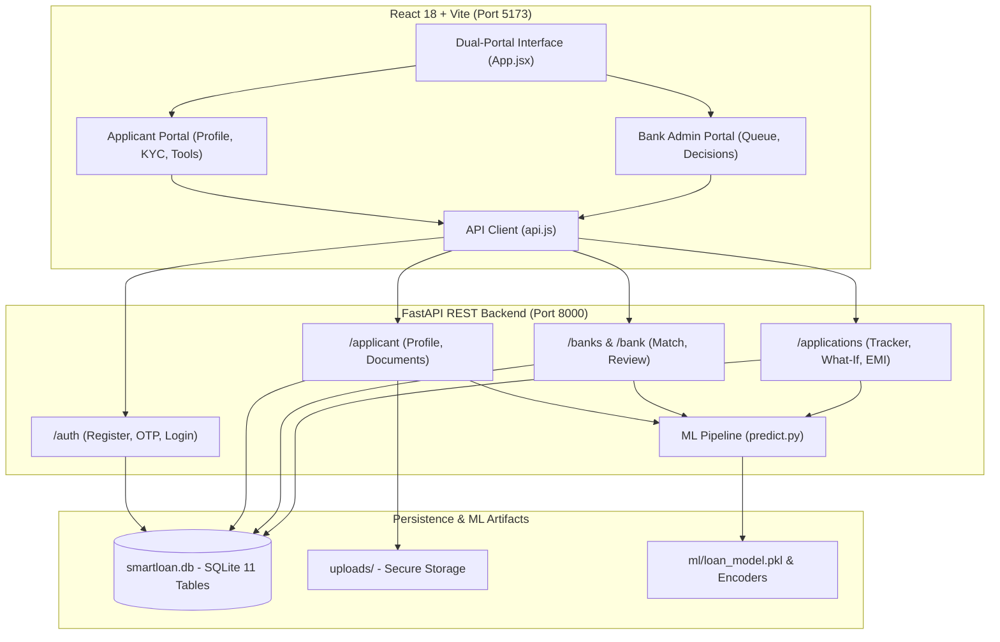

# SmartLoanAI — AI Banking & Multi-Lender Underwriting Platform

**SmartLoanAI** is a full-stack banking intelligence application designed for college Idea Lab evaluation. The platform combines machine learning risk estimation (XGBoost + SHAP feature attribution), an applicant portal with document verification, a reducing-balance EMI calculator, an interactive what-if simulator, a multi-bank comparison engine (SBI, HDFC Bank, ICICI Bank, Axis Bank), and an authorized bank officer underwriting terminal.

---

## 1. System Architecture



---

## 2. Prerequisites & Environment

- **Operating System:** Windows 10 / 11 (PowerShell)
- **Python:** 3.12 (64-bit)
- **Node.js:** v18+ or v20+ / v25+ (includes `npm`)

---

## 3. Installation & Setup (Windows PowerShell)

### Step 1: Environment Configuration
Copy the template configuration file to `.env`:
```powershell
Copy-Item .env.example .env
```
Key configuration parameters:
- `SMARTLOAN_DATABASE_URL=sqlite:///./smartloan.db`
- `SMARTLOAN_JWT_SECRET` (Secure JWT signing key)
- `SMARTLOAN_DEMO_OTP_ENABLED=true` (Pre-fills OTP for student testing)
- `SMARTLOAN_MAX_UPLOAD_BYTES=10485760` (10 MB upload cap)

### Step 2: Backend Dependencies & Virtual Environment
Ensure your Python virtual environment is ready:
```powershell
.\backend\venv\Scripts\python.exe -m pip install -r backend\requirements.txt
```

### Step 3: Database Migration & Initial Seeding
Run the non-destructive migration script to ensure all 11 tables, products, and default bank accounts are initialized:
```powershell
.\backend\venv\Scripts\python.exe backend\migrate_db.py
```

### Step 4: Machine Learning Pipeline
Train or verify the XGBoost classification model using the synthetic loan dataset:
```powershell
# Evaluate and test ML inference
.\backend\venv\Scripts\python.exe ml\predict.py
```

### Step 5: Frontend Dependencies & Production Build
In the `frontend` directory:
```powershell
cd frontend
npm.cmd install
npm.cmd run build
cd ..
```

---

## 4. Starting the Application

### Start Backend API Server (Terminal 1):
```powershell
.\backend\venv\Scripts\python.exe -m uvicorn backend.main:app --reload --port 8000
```
- API Base URL: `http://127.0.0.1:8000`
- Interactive OpenAPI Docs: `http://127.0.0.1:8000/docs`

### Start Frontend Dev Server (Terminal 2):
```powershell
cd frontend
npm.cmd run dev
```
- Frontend UI: `http://localhost:5173`

---

## 5. Automated Test Suite

A complete test suite is provided in `tests/test_api.py` covering authentication, email normalization, IDOR security, document upload limits, EMI calculations, bank matching, application submissions, and bank officer approvals:

Run tests using the project virtual environment:
```powershell
.\backend\venv\Scripts\python.exe -m pytest -v tests/test_api.py
```
> **Note:** Tests execute against an isolated sandbox database (`tests/test_sandbox/`) without altering production records in `smartloan.db`.

---

## 6. Demo Accounts (Local Idea Lab Evaluation)

### Applicant Account:
- **Email:** `pranshu2@test.com`
- **Password:** `Password123`
- *Or register a new account*: Enter your details and the demo OTP will automatically be pre-filled.

### Bank Officer Account:
- **Email:** `bank@smartloan.ai`
- **Password:** `bank-demo123`
- **Role:** Senior Credit Officer (Authorized for SBI underwriting review)

---

## 7. Idea Lab Demonstration Walkthrough

Follow these steps for a live project presentation:

1. **Applicant Registration & Login:**
   - Navigate to `http://localhost:5173`.
   - Toggle to **Applicant Portal** and sign in with `pranshu2@test.com`.
2. **Profile & Nagpur PIN Code Auto-Fill:**
   - Switch to **Financial Profile & Documents**.
   - Input PIN Code `440001` to demonstrate instant auto-population of **City: Nagpur**, **District: Nagpur**, **State: Maharashtra**.
   - Save profile to trigger instant background AI underwriting.
3. **AI Underwriting & SHAP Explainability:**
   - Go to **AI Underwriting & Score**.
   - Review the XGBoost statistical approval probability, risk level, and top influential factors (SHAP feature attribution).
   - Review actionable credit improvement recommendations.
4. **Multi-Lender Match Engine:**
   - Switch to **Multi-Bank Matcher**.
   - Review live comparison cards across **SBI**, **HDFC Bank**, **ICICI Bank**, and **Axis Bank**.
   - View match scores, starting rates, processing fee disclosures, and click **"Apply to Lender"** on SBI.
   - Enter requested amount and submit the loan application.
5. **Loan Application Lifecycle Tracking:**
   - Navigate to **Loan Tracker**.
   - View the newly submitted application in `Submitted` status with audit timestamp.
6. **Financial Calculators:**
   - Switch to **EMI & What-If Tools**.
   - Adjust the Reducing-Balance EMI sliders (handles 0% interest loans without division-by-zero).
   - Test the What-If Simulator by adjusting CIBIL score and EMI obligations to see simulated probability changes.
7. **Bank Officer Review & Decision:**
   - In the top bar, switch to **Bank Officer Portal**.
   - Sign in with `bank@smartloan.ai` / `bank-demo123`.
   - Review portfolio KPIs (Total applications, approval rate, average CIBIL).
   - Find the newly submitted loan in the queue and click **"Review Application"**.
   - Inspect applicant credit details, view uploaded documents, verify KYC proofs, select **"Approved"**, and record the official decision.
8. **Applicant Verification:**
   - Switch back to **Applicant Portal** $\rightarrow$ **Loan Tracker**.
   - Confirm the application status has updated to **Approved** with complete audit history.

---

## 8. Important Regulatory Disclosures

- **Synthetic Dataset:** All ML models are trained on synthetic applicant records generated specifically for college Idea Lab evaluation. Predictions represent statistical approximations and do not constitute actual bank credit sanctions.
- **Published Lender Data:** Bank interest rates, fees, and rules are based on publicly available bank disclosures and demo criteria. Official bank approval is subject to lender verification.
